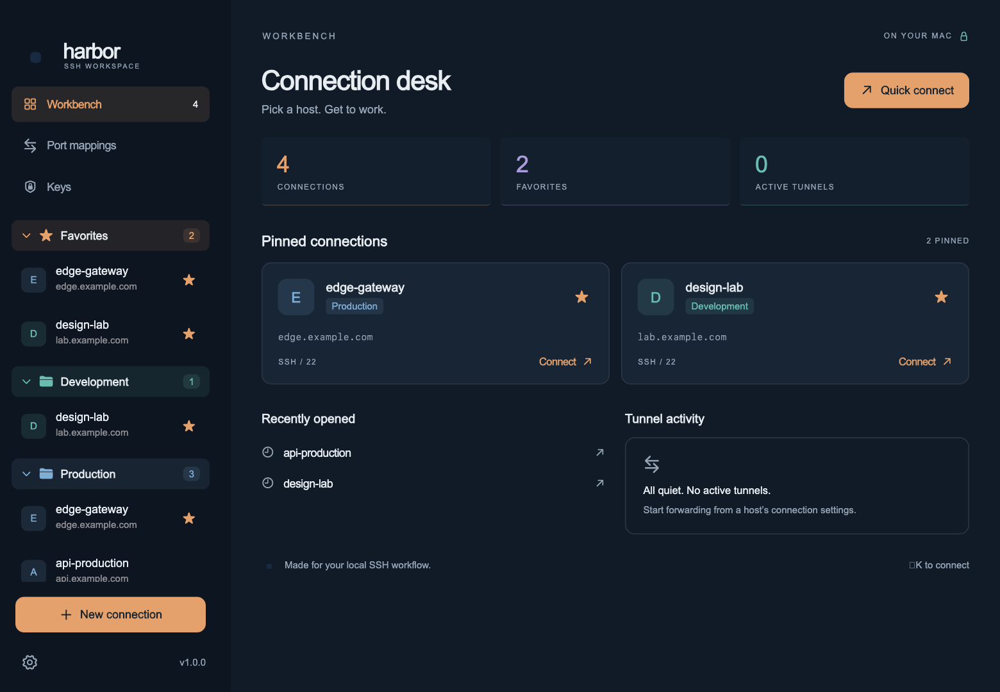
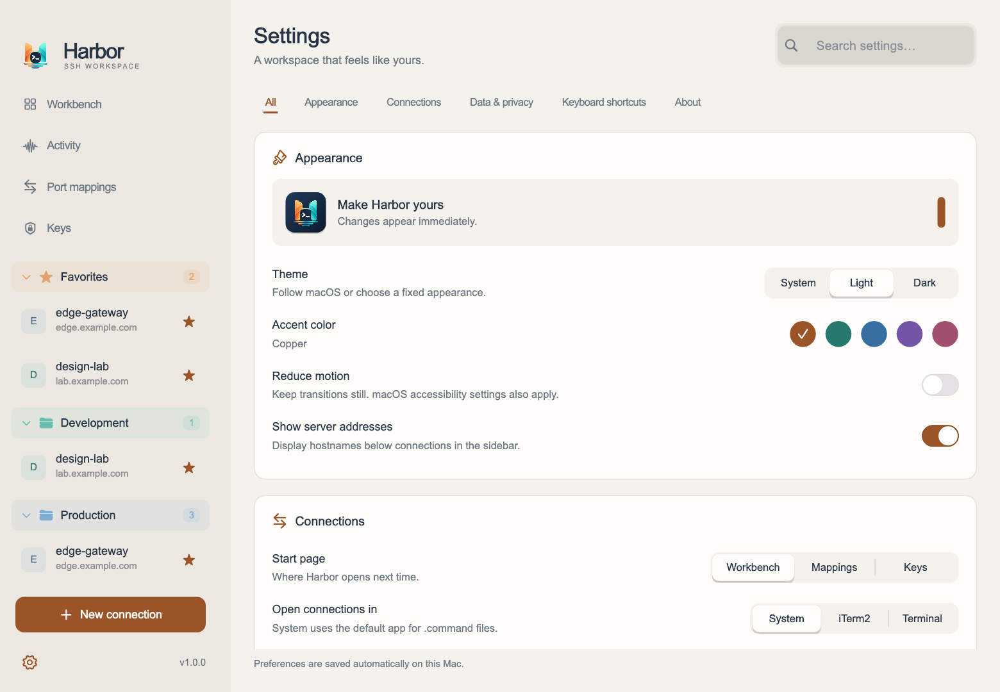

<p align="center">
  
</p>

<h1 align="center">Harbor</h1>

<p align="center">
  <strong>A window for the SSH work you keep doing in a terminal.</strong>
</p>

<p align="center">
  Hosts · Jump chains · Port forwards · Keys · Live activity<br />
  Built with Flutter for macOS.
</p>

<p align="center">
  
  
</p>

<p align="center">
  <strong>English</strong> · <a href="README_zh.md">简体中文</a>
</p>

---

<p align="center">
  
</p>

<p align="center">
  
</p>

## Everything in One Window

Harbor opens the `~/.ssh/config` you already have and gives it a real interface.
Browse and search your hosts, group them, forward ports, look after your keys, and
hand the actual connection to the terminal you already use — with no import step and
no second copy of your config to keep in sync.

### Hosts

- Reads and writes `~/.ssh/config` directly. Every save files a timestamped copy in `config_bk`, dropping the oldest once the folder passes 10 MB.
- Search by alias, address or group, with favorites, recent connections and
  collapsible groups.
- Jump chains, per-host users, ports and identity files.
- SSH options beyond the common ones, picked from a searchable list.
- An icon per host, a color and icon per group.
- Drag to reorder, drag between groups, or select several hosts and move them at once.
- Open a connection in iTerm2, Terminal, or whatever your default terminal is.

Harbor writes back only the connections it models. Comments, `Include` / `Match` blocks
and directives it does not recognise are left out of the rewrite, and the first save
reflows the file — a blank line between host blocks and one at the end. Earlier copies
stay in `config_bk`.

### Port Forwards

- Local, remote and SOCKS forwards on their own tab, each started, stopped and
  deleted on its own.
- Keep several per host and leave them running with no terminal open.
- Connection timeout and keep-alive that you can override for a single host.

### Keys

- Browse `~/.ssh`, check fingerprints and copy a public key in one click.
- Generate Ed25519 or RSA 4096 keys, or import the ones you already have.

### Activity

- Every OpenSSH process on the Mac with its connections, listening ports, PID and uptime.
- See at a glance which sessions Harbor started and which came from somewhere else.
- Probe a remote endpoint to find out how long connecting there actually takes.

### Make It Yours

- Light and dark, following the system or pinned.
- Five accent colors, reduced motion, searchable settings.
- Choose which page Harbor opens on and whether the sidebar shows addresses.

## Build

Harbor is under active development. To run it from source you need macOS, the
Flutter 3.38.9 SDK (see `.fvmrc`), Xcode with its command line tools, and CocoaPods
for the macOS plugins.

```sh
flutter pub get
flutter --no-version-check run -d macos
```

Release build:

```sh
flutter --no-version-check build macos --release
open build/macos/Build/Products/Release/Harbor.app
```

## Version naming

`pubspec.yaml` is the source of truth. The build number increases with every release.

| Field | Beta example | Stable example |
| --- | --- | --- |
| App/package version | `1.0.3-beta.1+5` | `1.0.3+7` |
| Git tag | `v1.0.3-beta.1` | `v1.0.3` |
| Release title / changelog heading | `1.0.3-beta.1` | `1.0.3` |
| Archive prefix | `Harbor-1.0.3-beta.1-` | `Harbor-1.0.3-` |

Use `.1`, `.2`, and so on for successive beta builds of the same version. Tags always
use a `v` prefix and never include the build number. macOS requires a numeric app
version, so it displays `1.0.3`; the build number identifies the exact update.
Public beta releases remain normal GitHub Releases marked Latest for in-app updates.
Release notes are written in English.

After updating the version and changelog, obtain and validate the tag with:

```sh
python3 scripts/release.py tag
python3 scripts/release.py preflight --tag v1.0.3-beta.1
```

Historical releases also have canonical `v<version>` tags. Original tags and release
assets remain as legacy download links; the canonical current release is marked Latest.

## License

Apache License 2.0 — see [LICENSE](LICENSE). Copyright 2026 mark455.
